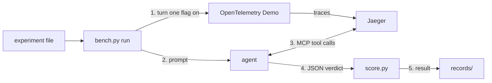

# jaeger-ai-evals

A harness for evaluating the MCP tools and skills Jaeger serves to AI agents, as [jaegertracing/jaeger#9135](https://github.com/jaegertracing/jaeger/issues/9135) asks. Each trial breaks one service in the OpenTelemetry Demo with a feature flag, lets an agent investigate with only Jaeger's MCP tools, and scores its JSON verdict against the known cause. The records show which tools the agent called, whether it named the cause, and every factor that could change the result. It keeps no leaderboard and does not rank models.



## Before you start

| Need | Detail |
|---|---|
| Tools | Python 3.11 or newer (standard library only), Docker with Compose v2, git, curl; `make preflight` checks them and the ports |
| Agent client | `run.client` `goose`, the default: Goose v1.57.0 in the image the Jaeger AI Assistant demo pins, through Docker, with `run.provider` `anthropic` or `openrouter`, `run.model` by full id, and that provider's key in `fixture.env`. The agent sees only Jaeger's MCP tools (plus Goose's `load_skill`, counted); any other tool scores INVALID. The mechanism grader follows the agent client: `GRADER_CLIENT` `goose` (default, same image, `GRADER_PROVIDER` and `GRADER_MODEL` falling back to `GOOSE_PROVIDER` and `GOOSE_MODEL`, no default model). The Claude Code CLI (`cli`, which ran every published result, and its grader) and `codex` (experimental) are in [docs/USAGE.md](docs/USAGE.md#other-clients) |
| Fixture | 22 containers (23 with Phoenix), about 2.9 GB RAM and 6 busy cores under load, a large first image pull; free ports 16686, 8013, 8016, 16006; boots the pinned release quay.io/jaegertracing/jaeger:2.23.0; `make measure` runs the Jaeger built from your checkout (main lineage); no other release is used or tested |
| Cost | Goose: depends on provider and model, recorded per trial. Claude CLI, published pair, 10 trials per arm: about 0.77 USD and 4.5 min baseline, 2.77 USD and 8 min variant. Plus a grader call per trial; attach `RESULT.md` and the batch directory under `records/` to a pull request; details in [docs/USAGE.md](docs/USAGE.md) |
| Host | `make` targets run on the fixture host, this machine by default; `bench.py` can drive a remote fixture over ssh |

## Quick Start

```bash
cp fixture.env.example fixture.env   # set GOOSE_PROVIDER, GOOSE_MODEL and that provider's key, as for the Jaeger AI Assistant demo (scripts/ai-sidecar/goose)
make setup     # free: install the fixture, pull the Goose image, start the demo and Phoenix, wait until Jaeger answers
make measure JAEGER=<jaeger-checkout> SCENARIO=<name>                   # paid: A/B your Jaeger commit against its base, on Goose
make smoke     # paid: one Goose trial end to end; CLIENT=cli runs it on the Claude Code CLI (log in once: claude)
python3 harness/bench.py run harness/experiments/<name>.json --dry-run  # free: checks everything, prints the plan
python3 harness/bench.py run harness/experiments/<name>.json            # paid: runs the trials and scores them
python3 harness/bench.py verify                                         # free: re-scores every run from its raw files
```

> [!WARNING]
> `make smoke` and `bench.py run` start paid agent trials. `make smoke` does its own dry run first and waits 5 seconds before spending.

Jaeger is at http://localhost:16686/jaeger/ui and Phoenix at http://localhost:16006. Stop with `make down`, remove the containers with `make clean`. Everything a batch does is set in one checked-in file, `harness/experiments/<name>.json`; no command-line flag changes a run. Below 10 trials per arm a result only ranks the arms.

## Layout and docs

| Path | What it is |
|---|---|
| `harness/` | `bench.py` (run, verify, gates), `score.py`, `judge.py`, agent clients, prompts, scenarios, experiments, tests |
| `fixture/` | the OpenTelemetry Demo overlay and its scripts: [FIXTURE.md](fixture/FIXTURE.md) |
| `records/` | batch records, one `RESULT.md` per judged experiment, and [INDEX.md](records/INDEX.md) |
| [docs/USAGE.md](docs/USAGE.md) | the experiment file, running a batch, protocol, thresholds, reading results, scoring |
| [docs/SCENARIOS.md](docs/SCENARIOS.md) | adding or editing a scenario |
| [docs/RECORD.md](docs/RECORD.md), [docs/TUNING.md](docs/TUNING.md) | every key a run records; each factor that can change a result |
| [docs/results/](docs/results/) | results pages; new ones start from [TEMPLATE.md](docs/results/TEMPLATE.md) |
| [CHANGELOG.md](CHANGELOG.md), [CONTRIBUTING.md](CONTRIBUTING.md) | scenario versions and comparability; tests and DCO sign-off |

Licensed under Apache 2.0; see LICENSE.
