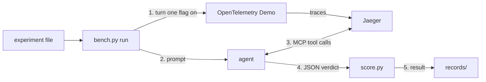

# jaeger-ai-evals

A harness that benchmarks the MCP tools and skills Jaeger serves to AI agents, as [jaegertracing/jaeger#9135](https://github.com/jaegertracing/jaeger/issues/9135) asks. It is for a Jaeger contributor who changed an MCP tool or skill and wants to know whether agents do better. Each trial breaks one service in the OpenTelemetry Demo with a feature flag, lets an agent investigate with only Jaeger's MCP tools, and scores its JSON verdict against the known cause. It keeps no leaderboard and does not rank models.



## Requirements

- make, Python 3.11 or newer (standard library only), git, curl
- Docker with Docker Compose 2.24 or newer
- Go, the version in Jaeger's `go.mod`, for `make measure` only
- About 2.9 GB RAM and 6 busy cores, a large first image pull, and free ports 16686, 8013, 8016 and 16006
- An API key for the model provider (Anthropic or OpenRouter)

`make preflight` checks the tools and ports. Ubuntu install steps are in [docs/USAGE.md](docs/USAGE.md#before-you-start).

## Quick Start

1. Clone the repository.

   ```bash
   git clone https://github.com/lopster568/jaeger-mcp-evals && cd jaeger-mcp-evals
   ```

2. Copy the settings file and set `OPENROUTER_API_KEY` in it. A free key covers a few smokes a day; `make measure` needs credits on the key or a paid model.

   ```bash
   cp fixture.env.example fixture.env
   ```

3. Set up the fixture. This is free: it pulls the Goose image, starts the demo and Phoenix, and waits until Jaeger answers.

   ```bash
   make setup
   ```

4. Run one trial end to end to prove the setup. This starts one paid trial, after a dry run and a 5 second wait.

   ```bash
   make smoke
   ```

5. Measure your change. This is the main job and it is paid. `JAEGER` is your Jaeger clone with the change committed on a branch, and `SCENARIO` is a file name in `harness/scenarios/` without `.json`. It builds two images, runs your commit and its base 10 times each, and asks before it spends.

   ```bash
   make measure JAEGER=~/jaeger SCENARIO=paymentFailure
   ```

6. Re-score every run from its raw files. This is free.

   ```bash
   make verify
   ```

Jaeger is at http://localhost:16686/jaeger/ui and Phoenix at http://localhost:16006.

Below 10 trials per arm a result only ranks the arms.

Goose is the default agent client. The Claude Code CLI (`cli`) ran every published result, and `codex` is experimental.

## Commands

| Target | What it does | Options |
|---|---|---|
| `make setup` | preflight, fixture, up, Goose image and Phoenix, in order |  |
| `make preflight` | check docker, Compose, git, curl, Python and the ports |  |
| `make fixture` | clone the OpenTelemetry Demo 3.0.0 and install the overlay |  |
| `make up` | start the demo and wait (10 minutes at most) until it answers |  |
| `make phoenix` | start the optional Phoenix trajectory store |  |
| `make smoke` | dry run, then one agent trial (paid) | `CLIENT=cli` or `codex` |
| `make measure` | A/B your Jaeger commit against its base with Fisher's exact test (paid) | `JAEGER=`, `SCENARIO=`, `CLIENT=cli` |
| `make test` | offline unit tests |  |
| `make verify` | re-score every trajectory under `RUNS_DIR` and check `records/INDEX.md` |  |
| `make down` | stop the demo containers, keeping their data |  |
| `make clean` | remove the demo containers and network (Jaeger traces are lost) |  |

Every target takes `PYTHON=` to pick another interpreter, e.g. `PYTHON=python3.12`. `make measure` has no passthrough for the flags below; to set `--base` or `--n`, call `harness/measure.sh` directly.

## Options

`python3 harness/bench.py run harness/experiments/<name>.json` runs the batch an experiment file describes. It is paid unless you pass `--dry-run`.

| Flag | Meaning |
|---|---|
| `--dry-run` | check and print every step without running a trial |
| `--first-only` | run one cell only |
| `--no-export` | do not send the batch to Phoenix at the end |

`bash harness/measure.sh <jaeger-checkout> <scenario> [flags]` is what `make measure` calls. It is paid unless you pass `--dry-run`.

| Flag | Meaning |
|---|---|
| `--base <ref>` | the base commit to compare against (default: merge-base of HEAD and `upstream/main`, else `origin/main`) |
| `--n <per-arm>` | trials per arm (default 10) |
| `--client goose\|cli` | the agent client (default `goose`) |
| `--yes` | skip the y/N question before committing the pair file |
| `--dry-run` | check and print every step without building, swapping or running |

Other `bench.py` subcommands are `verify`, `band`, `export`, `pack`, `index`, `power`, `leak`, `readiness`, `oracle` and `soak`; see [docs/USAGE.md](docs/USAGE.md#run-a-batch).

## Configuration

`fixture.env` holds the settings; an environment variable wins. The main keys:

| Key | Default | Meaning |
|---|---|---|
| `OPENROUTER_API_KEY` | none | Goose's key when `GOOSE_PROVIDER=openrouter` |
| `ANTHROPIC_API_KEY` | none | the key when `GOOSE_PROVIDER=anthropic` |
| `GOOSE_PROVIDER` | `openrouter` | `openrouter` or `anthropic` |
| `GOOSE_MODEL` | `nvidia/nemotron-3.5-lightning:free` | the agent model, by full id |
| `GRADER_CLIENT` | `goose` | `goose` or `cli`, the client that grades the mechanism |
| `GRADER_PROVIDER` | `GOOSE_PROVIDER` | the Goose grader's provider |
| `GRADER_MODEL` | `GOOSE_MODEL` | the grader's model; `claude-fable-5-1` for the `cli` grader |
| `SMOKE_CLIENT` | `goose` | the client `make smoke` uses: `goose`, `cli` or `codex` |
| `RUNS_DIR` | `runs` | where batch output goes |
| `FIXTURE_HOST` | `localhost` | the machine that runs the fixture |
| `FIXTURE_HOST_ONLY` | `0` | `1` on a fixture host that runs no agent |

The rest (ports, ssh user, `FIXTURE_DEMO_DIR`, `GRADER_BIN`, `CODEX_BIN`) are in `fixture.env.example`. Everything a batch does is set in one checked-in file, `harness/experiments/<name>.json`: see [The experiment file](docs/USAGE.md#the-experiment-file). Costs, grader choice and what to attach to a pull request are in [Pins, cost and what to attach](docs/USAGE.md#pins-cost-and-what-to-attach).

## Documentation

- [docs/USAGE.md](docs/USAGE.md): the experiment file, running a batch, protocol, thresholds, reading results, scoring
- [docs/SCENARIOS.md](docs/SCENARIOS.md): adding or editing a scenario
- [docs/RECORD.md](docs/RECORD.md): every key a run records
- [docs/TUNING.md](docs/TUNING.md): each factor that can change a result
- [fixture/FIXTURE.md](fixture/FIXTURE.md): the OpenTelemetry Demo overlay and a remote fixture host
- [docs/results/](docs/results/): results pages
- [records/INDEX.md](records/INDEX.md): every recorded batch
- [CHANGELOG.md](CHANGELOG.md): scenario versions and comparability

## Contributing

See [CONTRIBUTING.md](CONTRIBUTING.md). Run `make test` before you push, and sign off every commit with `git commit -s` (Developer Certificate of Origin).

## License

Apache 2.0; see [LICENSE](LICENSE).
